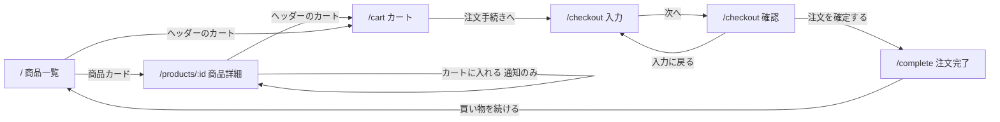

# Mockups — FUKUI BASICS（ローカルモックアップ）

> Stage: refined-mockups（Inception 2.5）· Depth: Minimal
> 入力: `stories.md`（US-1〜US-9）、`requirements.md`（FR-0〜FR-4、Priority）、`personas.md`、`team-practices.md`、`refined-mockups-questions.md`（Q1: A / Q2: A / Q3: B）
> アイデア出しフェーズのラフ案（`wireframes`、`user-flow`）は workshop スコープで省いたため存在しない。下のワイヤーフレームと画面の流れはこのステージで新しく作った。

## Screen Flow



<!-- Text fallback: 商品一覧から商品カードで商品詳細へ。詳細で「カートに入れる」を押しても画面は移動せず通知だけ出る。ヘッダーのカートからカート画面へ。カートから注文手続きの入力、次へで確認、確認から入力に戻れる。確認で注文を確定すると注文完了へ。完了から買い物を続けるで一覧に戻る。確認の段階（US-8）を削った場合は、入力の「次へ」で直接注文完了へ進む。 -->

確認の段階（US-8、Could）を削った場合は、入力の「次へ」で直接 `/complete` に進む。

## Common: Header（全画面、US-1 / FR-0.1）

```
PC (>1024px)
+--------------------------------------------------------------------+
| FUKUI BASICS                                          [ カート (3) ] |
+--------------------------------------------------------------------+

スマホ (<768px)
+-----------------------------------+
| FUKUI BASICS          [ カート 3 ] |
+-----------------------------------+
```

- ロゴは黒の太字テキスト「FUKUI BASICS」（赤い四角のロゴにはしない）。押すと `/`。
- カートのリンクは `/cart`。件数はカート内の数量の合計。0 のときも「カート (0)」と表示する。
- 画面上部に固定し、スクロールしても見える。

## Screen 1: 商品一覧 `/`（US-1、US-2）

```
PC: 4 列
+--------------------------------------------------------------------+
| FUKUI BASICS                                          [ カート (0) ] |
+--------------------------------------------------------------------+
| [すべて] [メンズ] [ウィメンズ] [キッズ]                            |
|                                                                    |
| +-------------+ +-------------+ +-------------+ +-------------+    |
| |   (写真)    | |   (写真)    | |   (写真)    | |   (写真)    |    |
| |             | |             | |             | |             |    |
| +-------------+ +-------------+ +-------------+ +-------------+    |
| | 商品名      | | 商品名      | | 商品名      | | 商品名      |    |
| | ¥1,990      | | ¥2,990      | | ¥3,990      | | ¥3,990      |    |
| | o o o       | | o o         | | o o         | | o o         |    |
| +-------------+ +-------------+ +-------------+ +-------------+    |
|  ... (3 行で 12 商品)                                              |
+--------------------------------------------------------------------+

スマホ: 2 列（タブレット 768-1024px は 3 列）
+-----------------------------------+
| [すべて][メンズ][ウィメンズ][キッズ] |  <- 横スクロール可のタブ
| +---------------+ +---------------+ |
| |    (写真)     | |    (写真)     | |
| | 商品名        | | 商品名        | |
| | ¥1,990        | | ¥2,990        | |
| +---------------+ +---------------+ |
+-----------------------------------+
```

- カード全体がリンク。写真は縦長 3:4 で切り抜き表示。下に色見本の小さな丸（その商品のカラー数）。
- カテゴリタブは選択中を赤の下線と太字で示す（`aria-pressed`）。〔Should: US-2〕
- 写真を同梱できなかった商品は、写真の枠に、1 色目のカラーコード（下の表）で塗った色付きの枠を表示し、商品名とカラー名を書く（FR-0.3、US-1）。

## Screen 2: 商品詳細 `/products/:id`（US-3、US-4）

```
PC: 左に写真、右に情報
+--------------------------------------------------------------------+
| FUKUI BASICS                                          [ カート (1) ] |
+--------------------------------------------------------------------+
| < 一覧に戻る                                                       |
| +---------------------------+  メンズ                              |
| |                           |  スーピマコットン クルーネック T シャツ |
| |          (写真)           |  ¥1,990（税込）                       |
| |                           |                                       |
| |                           |  カラー: ネイビー                     |
| |                           |  (o) (o) (o)   <- 色見本              |
| +---------------------------+                                       |
|                                 サイズ                               |
|                                 [ S ] [ M ] [ L ] [XL]               |
|                                                                      |
|                                 [     カートに入れる     ]  <- 赤      |
|                                 カラーとサイズを選んでください        |
|                                                                      |
|                                 説明文 ...                           |
+--------------------------------------------------------------------+
| (通知) カートに追加しました  [カートを見る]     <- 画面下部に 3 秒    |
+--------------------------------------------------------------------+

スマホ: 写真 → 情報 → ボタンの縦並び。ボタンは横幅いっぱい。
```

- カラーとサイズの両方を選ぶまで「カートに入れる」は無効（グレー）で、ボタンの下に「カラーとサイズを選んでください」と表示する。
- 押すと 1 個追加し、画面下部に「カートに追加しました」と「カートを見る」リンクの通知を 3 秒表示する（Q2: A）。マウスを重ねている間とフォーカスがある間は消さない。詳細画面にとどまる。
- 同じ商品・カラー・サイズがすでに 10 個のときは追加せず、ボタンの下に「!」アイコン付きで「同じ商品は 10 点までです」と表示する。この表示はカラーかサイズを選び直すまで消えない〔Should: FR-3.4〕。
- キッズ商品のサイズは 110 / 120 / 130 / 140。
- 存在しない ID のときは、写真と情報の代わりに次を表示する。〔Should: US-4〕

```
+--------------------------------------------------------------------+
| FUKUI BASICS                                          [ カート (1) ] |
+--------------------------------------------------------------------+
|                    商品が見つかりません                             |
|                    [ 商品一覧へ戻る ]                               |
+--------------------------------------------------------------------+
```

## Screen 3: カート `/cart`（US-5、US-6）

```
PC
+--------------------------------------------------------------------+
| FUKUI BASICS                                          [ カート (3) ] |
+--------------------------------------------------------------------+
| カート                                                             |
| +------+---------------------------+--------+-------+--------+---+ |
| |(写真)| キッズ スウェット パーカー | ¥1,990 | [2 v] | ¥3,980 | x | |
| |      | グレー / 120              |        |       |        |   | |
| +------+---------------------------+--------+-------+--------+---+ |
| |(写真)| キッズ スウェット パーカー | ¥1,990 | [1 v] | ¥1,990 | x | |
| |      | グレー / 140              |        |       |        |   | |
| +------+---------------------------+--------+-------+--------+---+ |
|                                           合計（税込） ¥5,970       |
|                                     [   注文手続きへ   ]  <- 赤     |
|                                     < 買い物を続ける                |
+--------------------------------------------------------------------+

空のとき
| カート                                                             |
|                     カートは空です                                 |
|                     [ 商品一覧へ ]                                 |
```

- 数量は 1〜10 のセレクトボックス〔Should: FR-3.2〕。変更するとすぐ小計・合計・ヘッダー件数が変わる。削除は Must。
- 「x」は削除ボタン（`aria-label="〔商品名〕〔カラー〕〔サイズ〕を削除"`）。確認ダイアログは出さない。
- スマホでは 1 行を「写真＋商品名・カラー/サイズ＋単価」と「数量・小計・削除」の 2 段に分ける。

## Screen 4: 注文手続き `/checkout`（US-7、US-8）

```
入力の段階
+--------------------------------------------------------------------+
| FUKUI BASICS                                          [ カート (3) ] |
+--------------------------------------------------------------------+
| ご注文手続き      (1) 配送先の入力 > (2) 確認                       |
|                                                                    |
| 氏名 *            [                         ]                       |
| 郵便番号 *        [         ]  例: 123-4567                         |
|                   ! 郵便番号は 7 桁の数字で入力してください          |
| 住所 *            [                                         ]       |
| 電話番号 *        [               ]  例: 090-1234-5678               |
| メールアドレス *  [                         ]                       |
|                                                                    |
| お支払い方法                                                       |
| (*) クレジットカード（デモ）   ( ) 代金引換（デモ）                  |
|     ※ デモのため、カード番号の入力や実際の決済は行いません          |
|                                                                    |
| 注文金額（税込） ¥5,970        [      次へ      ]  <- 赤            |
+--------------------------------------------------------------------+

確認の段階〔Could: US-8〕
| ご注文手続き      (1) 配送先の入力 > (2) 確認                       |
| 商品: キッズ スウェット パーカー グレー/120 x2 ... ¥3,980            |
|       キッズ スウェット パーカー グレー/140 x1 ... ¥1,990            |
| 合計（税込）: ¥5,970                                               |
| 配送先: 田中 健太 / 〒123-4567 / 福井県... / 090... / ...           |
| お支払い方法: クレジットカード（デモ）                             |
|            [ 入力に戻る ]   [   注文を確定する   ]  <- 赤           |
```

- エラーは「次へ」を押したときに、各項目の下に「!」アイコンと文言で表示し、最初のエラー項目にフォーカスを移す。
- 必須チェックは Must、形式チェック（郵便番号 7 桁、電話番号 10〜11 桁、メール形式）は時間が足りなければ削る〔Could〕。ハイフンは無視して判定する。
- 「入力に戻る」で入力内容を保ったまま戻る。入力内容はブラウザに保存しない（NFR-2）。
- カートが空のまま `/checkout` を開いたときは `/cart` に移動する〔Should: FR-4.6〕。

## Screen 5: 注文完了 `/complete`（US-9）

```
+--------------------------------------------------------------------+
| FUKUI BASICS                                          [ カート (0) ] |
+--------------------------------------------------------------------+
|                ご注文ありがとうございました                         |
|                注文番号: FB-20261003-4821                           |
|                ※ デモのため、実際には発送されません               |
|                [   買い物を続ける   ]                               |
+--------------------------------------------------------------------+
```

- 注文番号は `FB-YYYYMMDD-` ＋ 4 桁の乱数。
- 注文を確定していないのに開いたときは `/` に移動する〔Should: FR-4.6〕。

## Dummy Catalogue（12 商品）

写真は code-generation で Unsplash から 1 枚ずつ探す。1 色目は見つかった写真の服の色に合わせて変えてよい。

| ID | カテゴリ | 商品名 | 種類 | 税込価格 | カラー（1 色目が写真の色） | サイズ |
|----|----------|--------|------|----------|----------------------------|--------|
| m-01 | メンズ | スーピマコットン クルーネック T シャツ | T シャツ | ¥1,990 | ホワイト、ネイビー、グレー | S / M / L / XL |
| m-02 | メンズ | オックスフォード シャツ | シャツ | ¥2,990 | ホワイト、ブルー | S / M / L / XL |
| m-03 | メンズ | スウェット プルパーカー | パーカー | ¥3,990 | グレー、ブラック | S / M / L / XL |
| m-04 | メンズ | ストレッチ チノパンツ | パンツ | ¥3,990 | ベージュ、ネイビー | S / M / L / XL |
| w-01 | ウィメンズ | リブ クルーネック T シャツ | T シャツ | ¥1,500 | ホワイト、ブラック、ピンク | S / M / L / XL |
| w-02 | ウィメンズ | リネンブレンド シャツ | シャツ | ¥2,990 | ホワイト、ベージュ | S / M / L / XL |
| w-03 | ウィメンズ | フレアスカート | スカート | ¥2,990 | ブラック、ベージュ | S / M / L / XL |
| w-04 | ウィメンズ | デニム ジャケット | ジャケット | ¥4,990 | ブルー | S / M / L / XL |
| k-01 | キッズ | キッズ カラー T シャツ | T シャツ | ¥990 | イエロー、ブルー、ホワイト | 110 / 120 / 130 / 140 |
| k-02 | キッズ | キッズ スウェット パーカー | パーカー | ¥1,990 | グレー、ネイビー | 110 / 120 / 130 / 140 |
| k-03 | キッズ | キッズ デニム パンツ | パンツ | ¥1,990 | ブルー | 110 / 120 / 130 / 140 |
| k-04 | キッズ | キッズ ワンピース | ワンピース | ¥1,990 | ピンク、ネイビー | 110 / 120 / 130 / 140 |

## Review

**Verdict**: READY

レビュー担当: aidlc-product-lead-agent（Minimal 深度で判定）

良い点: 5 画面とパス（`/`、`/products/:id`、`/cart`、`/checkout`、`/complete`）、カート 1 行の上限 10、キッズのサイズ 110〜140、カード番号の入力欄なし、写真は Unsplash から取って `public/images/` に同梱、のいずれも `requirements.md` と `stories.md` と一致している。Q1（PC 4 列・スマホ 2 列）、Q2（詳細画面にとどまり通知）、Q3（赤、ロゴは黒文字にして実在ブランドと区別）が反映されている。空のカート、存在しない商品、入力エラー、US-8 を削った場合の流れまで画面に描かれていて、コード生成で 5 画面を作れる。以下はすべて、コード生成の前に直すか、コード生成のときに決めれば足りる。

1. **[non-blocking] ダミー商品の表に、作るのに必要なデータが 2 つ足りない。** (a) US-3 の受け入れ条件と FR-2.1 では詳細画面に説明文を出すが、表に説明文の列がない。(b) 色見本の丸に塗る色（ホワイト、ネイビー、ベージュ、イエローなど 11 色）の色コードがどこにもない。このままでは開発者が 12 商品分の説明文と色を自分で考えることになる。表に説明文の列（1〜2 文）を足し、`design-system-mapping.md` に「カラー名 → 色コード」の表を足す。ホワイトの色見本は白い背景に溶けるので、枠線を付けることも書く。
2. **[non-blocking] 商品写真の代替テキストと、写真がないときの枠があいまい。** (a) 代替テキストは「〔カラー〕の〔商品名〕」だが、写真は商品ごとに 1 枚で色を変えても変わらない（FR-2.5）。カートでネイビーを選んだ行に、白い服の写真が「ネイビーの…」と読み上げられる。代替テキストのカラーは、選んだ色ではなく常に 1 色目（写真の色）を使う、と書く。(b) 写真がないときの枠は「薄いグレー」だが、FR-0.3 と US-1 では「色付きの枠」になっている。グレーにするなら要件の言い方に合わせて「色付き」をどう解釈したかを書くか、1 色目の色で塗る（文字とのコントラストに注意）かを決める。
3. **[non-blocking] 3 秒で消える通知（Toast）に、読み切れない・届かない内容が載っている。** (a) `interaction-spec.md` では「Toast 内のリンクは Tab で届く」とあるが、フォーカスはボタンに残るので、3 秒以内にキーボードで「カートを見る」まで移るのは難しい。(b) 上限エラー「同じ商品は 10 点までです」も Toast で 3 秒で消え、`accessibility-checklist.md` の A-3（エラーは「!」アイコンと文言で示す）の対象なのに、Toast の仕様に「!」がない。マウスを乗せている間やフォーカスがある間は消さない、エラーのときは「!」を付ける（またはボタンの下に残る文言で出す）のどちらかを書く。カートへはヘッダーのリンクからも行けるので、Tab で届く、の記述を外すのでもよい。
4. **[non-blocking] 文書の間の細かい食い違い。** (a) `mockups.md` では、Should の項目に印がないものがある。カートの数量の変更（FR-3.2 の削除以外）、上限 10 のメッセージ（FR-3.4）、`/complete` を直接開いたときの移動（FR-4.6）。また、カートが空で `/checkout` を開いたときの移動（FR-4.6）は `interaction-spec.md` にしかなく、画面 4 に書かれていない。時間切れで削ったときに不合格に見えないよう、〔Should〕を付けて画面 4 にも 1 行足す。(b) `interaction-spec.md` は「部品の境界 3:1」としているが、枠線のトークン `--color-border`（`#D9D9D9`）は白の背景に対して約 1.4:1 しかなく、入力欄や選んでいないサイズのボタンの枠が見えにくい。入力欄やボタンの枠用に濃い色（例: `#767676`、約 4.5:1）のトークンを足すか、3:1 の記述を外す。

## Product Descriptions and Colour Codes（レビュー指摘 1 への対応）

### 商品説明（詳細画面に表示、FR-2.1）

| ID | 説明 |
|----|------|
| m-01 | なめらかで丈夫なスーピマコットンを使った、1 枚で着ても重ね着にも使える定番の T シャツ。 |
| m-02 | しっかりした織りのオックスフォード生地。仕事にも休日にも合わせやすいボタンダウンシャツ。 |
| m-03 | 裏毛のやわらかいスウェット生地。フードと前ポケット付きのリラックスしたシルエット。 |
| m-04 | 伸びる生地で動きやすいチノパンツ。すっきりしたテーパードシルエット。 |
| w-01 | 体にほどよく沿うリブ編み。インナーにも 1 枚でも着られるクルーネック T シャツ。 |
| w-02 | リネン混の風通しのよい生地。羽織りにも使えるゆったりしたシャツ。 |
| w-03 | 歩くたびに揺れるフレアシルエット。ウエストはゴムで楽にはける。 |
| w-04 | 程よい厚みのデニム生地。季節を問わず羽織れる定番のジャケット。 |
| k-01 | 元気な色がそろうキッズ用 T シャツ。洗濯に強いコットン 100%。 |
| k-02 | 着脱しやすいキッズ用パーカー。肌寒い日の羽織りにも。 |
| k-03 | ウエストゴムで動きやすいキッズ用デニムパンツ。 |
| k-04 | 1 枚でコーディネートが決まるキッズ用ワンピース。 |

### カラーコード（色見本と、写真がないときの枠に使う）

| カラー名 | コード | 備考 |
|----------|--------|------|
| ホワイト | `#FFFFFF` | 白背景で見えないため、色見本と枠に `#767676` の 1px の線を付ける |
| ブラック | `#1A1A1A` | |
| グレー | `#9E9E9E` | |
| ネイビー | `#1F2A44` | |
| ブルー | `#3B6EA5` | |
| ベージュ | `#D8C3A5` | |
| ピンク | `#F2B8C6` | |
| イエロー | `#F4D35E` | |

- 商品写真の代替テキストは、選んだカラーにかかわらず常に「〔1 色目（写真の色）〕の〔商品名〕」にする（写真の色は変わらないため）。

**Builder response**: レビュー指摘 1〜4 を反映した（商品説明とカラーコードの追加、代替テキストは常に 1 色目、写真がないときは色付きの枠、通知はマウスを重ねている間とフォーカス中は消さない、上限エラーはボタン下に「!」付きで残す、Should の明記、`/checkout` のリダイレクトを画面 4 に追記、入力欄とボタンの枠線は `#767676`）。
